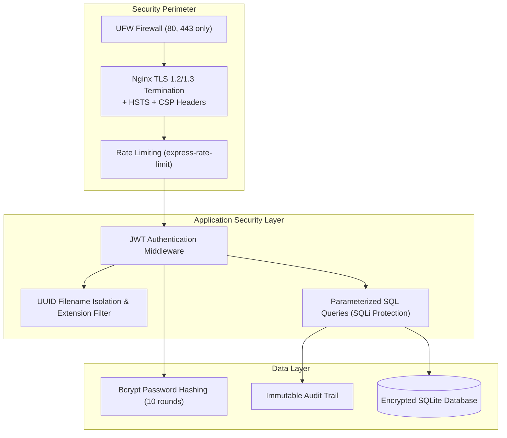

# DevOps Stored Data - Architecture & Security Specification

This document details the software architecture, technical stack selection, requirements matrix, security safeguards, and monitoring framework for **DevOps Stored Data**.

---

## 1. Requirements Identification & Traceability Matrix

| Requirement Area | Detailed Specification | Implemented Feature |
| :--- | :--- | :--- |
| **Authentication & RBAC** | Secure multi-user login, bcrypt password hashing, JWT session tokens, role-based permissions (`admin`, `engineer`, `viewer`). | `auth.routes.js`, `auth.js` middleware, `Login.jsx` |
| **POC Repository** | Store, document, categorize, and tag DevOps Proofs of Concept with execution summaries and technical architecture specs. | `pocs.routes.js`, `Pocs.jsx` with markdown viewer |
| **Project & Task Management** | Kanban board & list view with stages (`Backlog`, `In Progress`, `Review`, `Completed`, `Blocked`), priorities, assignees, due dates. | `tasks.routes.js`, `Tasks.jsx` |
| **Resource & File Vault** | Upload, store, download, and live-preview configuration files (`.yaml`, `.tf`, `.json`, `.conf`), scripts (`.sh`, `.py`, `.ps1`), logs, and diagrams. | `files.routes.js`, `Files.jsx`, Multer middleware |
| **Runbooks & Notes** | Centralized documentation for standard operating procedures (SOPs), incident recovery, and command cheat sheets. | `notes.routes.js`, `Notes.jsx` |
| **Search & Filtering** | Instant full-text search across titles, descriptions, tags, categories, and environments. | Parameterized SQL search in routes |
| **Audit Logging** | Immutable audit trail tracking user logins, file uploads, task updates, and deletions with timestamps and IP addresses. | `audit_logs` table, `auditService.js`, `Audit.jsx` |
| **Domain & SSL Deployment** | Deploy with clean URL (`https://devops.example.com`) without ports or IPs, automated Let's Encrypt renewal, and Nginx reverse proxy. | `nginx.conf`, `certbot-ssl-setup.sh`, `DEPLOYMENT_AND_DOMAIN_SETUP_GUIDE.md` |
| **Automated Backups** | Daily hot database snapshot, file vault archival, and retention rotation (keep last 7 days). | `backup.sh`, `backup.ps1`, `restore.sh` |
| **System Monitoring** | Real-time health check endpoint and Prometheus-compatible metrics export. | `/health`, `/metrics`, `Deployment.jsx` |

---

## 2. Technology Stack Selection & Justification

| Layer | Selected Technology | Technical Justification |
| :--- | :--- | :--- |
| **Backend Runtime** | Node.js (v20+ LTS) | High I/O performance for concurrent file uploads/downloads, event-driven architecture, cross-platform portability across Windows and Linux servers. |
| **Web Framework** | Express.js | Mature, flexible HTTP layer supporting robust middleware chains (Helmet, Rate Limiting, CORS, Multer, JWT). |
| **Database Engine** | SQLite with WAL Mode | Zero-dependency, ultra-fast embedded ACID database engine. With Write-Ahead Logging (`WAL`), it supports high concurrent reads and writes, atomic single-file backups, and eliminates external database maintenance overhead while remaining swappable with PostgreSQL. |
| **Frontend Framework** | React 19 + Vite | Fast HMR during development, sub-4-second optimized production builds, modular component architecture. |
| **Styling & UI** | Tailwind CSS + Lucide Icons | Responsive, modern dark cybersecurity theme tailored for DevOps engineers, with clean icons and accessible typography. |
| **Reverse Proxy** | Nginx | Standard enterprise reverse proxy for SSL termination, port masking (maps internal port 5000 to standard 443), Gzip compression, and rate limiting. |
| **SSL/TLS Security** | Let's Encrypt + Certbot | Free, automated industry-standard TLS certificates with automated cron/systemd renewal. |
| **Containerization** | Docker & Docker Compose | Multi-stage build yielding minimal image footprints with volume persistence and healthcheck probes. |

---

## 3. Security Threat Model & Safeguards

### Security Defenses Implemented:
1. **Zero Port Exposure**:
   The application listens internally on `127.0.0.1:5000` (or Docker bridge network). Outside connections must traverse Nginx on port 443. Port 5000 is explicitly blocked on the firewall.
2. **Brute-Force & DoS Protection**:
   Authentication endpoints (`/api/auth/login`) are restricted to 20 attempts per 15-minute window via `express-rate-limit`. General API requests are throttled at 500 requests per 15 minutes. Nginx also applies an IP-based burst rate limit (`limit_req_zone`).
3. **Password Security**:
   Passwords are never stored in plaintext. They are salted and hashed using `bcryptjs` with 10 salt rounds.
4. **JWT Authentication & Stateless Tokens**:
   All protected routes require a signed JSON Web Token (`Authorization: Bearer <TOKEN>`) with 7-day expiration. The user record is verified in SQLite on each request.
5. **Path Traversal & Malicious File Upload Prevention**:
   Uploaded files are assigned randomized UUID filenames on disk (`${Date.now()}-${uuid}${ext}`) rather than retaining user-supplied paths, preventing directory traversal attacks. Dangerous executable types (`.exe`, `.dll`, `.so`, `.vbs`) are blocked.
6. **SQL Injection Defense**:
   All database operations utilize parameterized prepared statements via `better-sqlite3` (`db.prepare('... WHERE id = ?').get(id)`). No raw string interpolation is used.
7. **HTTP Security Headers**:
   - `Strict-Transport-Security` (HSTS): Enforces HTTPS for 2 years including subdomains.
   - `X-Frame-Options: SAMEORIGIN`: Prevents clickjacking.
   - `X-Content-Type-Options: nosniff`: Prevents MIME-sniffing exploits.

---

## 4. Monitoring & Observability

- **Health Probe (`/health`)**:
  Returns a structured JSON payload containing uptime, system load, memory usage, and a database ping check (`SELECT 1`). Suitable for Kubernetes liveness/readiness probes, AWS ALB target group health checks, or Uptime Kuma.
- **Prometheus Metrics (`/metrics`)**:
  Exposes Prometheus text-format metrics including process heap memory, total registered POCs, task counts by stage, stored files, and disk storage utilized.
