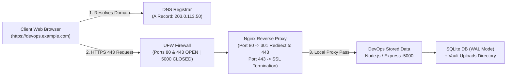

# DevOps Stored Data - Deployment & Custom Domain Setup Guide

This guide provides end-to-end instructions for deploying **DevOps Stored Data** on a server with a custom domain name (e.g., `https://devops.example.com`). The deployment ensures that **no IP address or port number (such as `:5000` or `:8080`) is exposed in the browser URL**, enforcing strict HTTPS encryption via Let's Encrypt SSL/TLS certificates and an enterprise-grade Nginx reverse proxy.

---

## Architecture Overview



---

## Step 1: Domain & DNS Configuration

Before configuring the server, point your custom domain or subdomain to the server's public IP address.

### 1. Configure DNS Records at Your Registrar
Log into your DNS provider (Cloudflare, AWS Route 53, GoDaddy, Namecheap, Google Domains) and add the following record:

| Type | Host / Name | Value / Target | TTL | Purpose |
| :--- | :--- | :--- | :--- | :--- |
| **A Record** | `devops` | `<YOUR_SERVER_PUBLIC_IP>` (e.g., `203.0.113.50`) | 300s / Auto | Directs `devops.yourdomain.com` to your server |
| *(Alternative)* **CNAME** | `devops` | `server.yourdomain.com` | Auto | Uses hostname alias if using dynamic DNS |

### 2. Verify DNS Propagation
Run these commands from your local computer or server:

```bash
# Verify A record resolution
dig +short devops.example.com

# On Windows PowerShell
Resolve-DnsName devops.example.com
```

> [!IMPORTANT]
> Ensure the output returns your server's public IP before proceeding to SSL certificate issuance, otherwise Let's Encrypt validation will fail.

---

## Step 2: Server Security & Firewall Configuration

Harden the Linux compute instance (Ubuntu 22.04 / 24.04 LTS recommended):

```bash
# Update system packages
sudo apt update && sudo apt upgrade -y

# Configure UFW Firewall: Only allow SSH, HTTP (80), and HTTPS (443)
sudo ufw default deny incoming
sudo ufw default allow outgoing
sudo ufw allow ssh
sudo ufw allow 80/tcp
sudo ufw allow 443/tcp

# CRITICAL: Keep application port 5000 blocked from public access
sudo ufw deny 5000/tcp

# Enable firewall
sudo ufw enable
sudo ufw status verbose
```

---

## Step 3: Application Deployment Options

You can deploy using either **Docker Compose** (recommended for isolation and portability) or **Linux Systemd Service**.

### Option A: Deployment via Docker Compose (Recommended)

1. Clone or copy `devops-stored-data` to `/opt/devops-stored-data` on your server:
   ```bash
   sudo mkdir -p /opt/devops-stored-data
   sudo chown -R $USER:$USER /opt/devops-stored-data
   cd /opt/devops-stored-data
   ```

2. Review and configure environment variables:
   ```bash
   cp .env.example .env
   # Edit .env and set your custom JWT_SECRET and CORS_ORIGIN
   nano .env
   ```

3. Launch the application stack:
   ```bash
   cd docker
   docker compose up -d --build
   ```

4. Verify health and container status:
   ```bash
   docker compose ps
   docker compose logs -f app
   ```

---

### Option B: Bare-Metal Deployment via Linux Systemd

1. Install Node.js (v20+ LTS) and Git:
   ```bash
   curl -fsSL https://deb.nodesource.com/setup_20.x | sudo -E bash -
   sudo apt install -y nodejs build-essential
   ```

2. Install dependencies and build production frontend:
   ```bash
   cd /opt/devops-stored-data
   npm install --production=false
   npm run build
   ```

3. Create the Systemd service unit:
   ```bash
   sudo tee /etc/systemd/system/devops-stored-data.service > /dev/null <<EOF
   [Unit]
   Description=DevOps Stored Data Application Server
   After=network.target

   [Service]
   Type=simple
   User=www-data
   WorkingDirectory=/opt/devops-stored-data
   ExecStart=/usr/bin/node backend/src/server.js
   Restart=always
   RestartSec=5
   Environment=NODE_ENV=production
   Environment=PORT=5000
   Environment=DB_PATH=/opt/devops-stored-data/backend/data/devops_stored.sqlite
   Environment=UPLOADS_DIR=/opt/devops-stored-data/backend/uploads
   Environment=CORS_ORIGIN=https://devops.example.com

   [Install]
   WantedBy=multi-user.target
   EOF
   ```

4. Set directory permissions and start the service:
   ```bash
   sudo chown -R www-data:www-data /opt/devops-stored-data/backend/data /opt/devops-stored-data/backend/uploads
   sudo systemctl daemon-reload
   sudo systemctl enable devops-stored-data
   sudo systemctl start devops-stored-data
   sudo systemctl status devops-stored-data
   ```

---

## Step 4: Nginx Reverse Proxy & Let's Encrypt SSL

1. Install Nginx and Certbot:
   ```bash
   sudo apt install -y nginx certbot python3-certbot-nginx
   ```

2. Create the Nginx site configuration:
   ```bash
   sudo nano /etc/nginx/sites-available/devops_stored_data.conf
   ```

   Paste the following configuration (replace `devops.example.com` with your domain):

   ```nginx
   server {
       listen 80;
       listen [::]:80;
       server_name devops.example.com;

       location /.well-known/acme-challenge/ {
           root /var/www/certbot;
           allow all;
       }

       location / {
           return 301 https://$host$request_uri;
       }
   }
   ```

3. Enable the site and test configuration:
   ```bash
   sudo ln -sf /etc/nginx/sites-available/devops_stored_data.conf /etc/nginx/sites-enabled/
   sudo nginx -t
   sudo systemctl reload nginx
   ```

4. Request the SSL Certificate via Certbot:
   ```bash
   sudo certbot --nginx -d devops.example.com --non-interactive --agree-tos -m admin@example.com
   ```

5. Update `/etc/nginx/sites-available/devops_stored_data.conf` to full production specification:

   ```nginx
   # Upstream Node.js application
   upstream devops_backend {
       server 127.0.0.1:5000;
       keepalive 32;
   }

   # HTTP -> HTTPS redirect
   server {
       listen 80;
       listen [::]:80;
       server_name devops.example.com;
       return 301 https://$host$request_uri;
   }

   # HTTPS Server
   server {
       listen 443 ssl http2;
       listen [::]:443 ssl http2;
       server_name devops.example.com;

       # SSL Certificates managed by Certbot
       ssl_certificate /etc/letsencrypt/live/devops.example.com/fullchain.pem;
       ssl_certificate_key /etc/letsencrypt/live/devops.example.com/privkey.pem;

       # TLS Hardening
       ssl_protocols TLSv1.2 TLSv1.3;
       ssl_prefer_server_ciphers off;
       ssl_ciphers 'ECDHE-ECDSA-AES128-GCM-SHA256:ECDHE-RSA-AES128-GCM-SHA256:ECDHE-ECDSA-AES256-GCM-SHA384:ECDHE-RSA-AES256-GCM-SHA384';

       # Enterprise Security Headers
       add_header Strict-Transport-Security "max-age=63072000; includeSubDomains; preload" always;
       add_header X-Frame-Options "SAMEORIGIN" always;
       add_header X-Content-Type-Options "nosniff" always;
       add_header Referrer-Policy "strict-origin-when-cross-origin" always;

       client_max_body_size 50M;

       # Gzip Compression
       gzip on;
       gzip_types text/plain text/css application/json application/javascript image/svg+xml;

       location / {
           proxy_pass http://devops_backend;
           proxy_http_version 1.1;
           proxy_set_header Upgrade $http_upgrade;
           proxy_set_header Connection 'upgrade';
           proxy_set_header Host $host;
           proxy_set_header X-Real-IP $remote_addr;
           proxy_set_header X-Forwarded-For $proxy_add_x_forwarded_for;
           proxy_set_header X-Forwarded-Proto $scheme;
       }
   }
   ```

6. Test and reload Nginx:
   ```bash
   sudo nginx -t
   sudo systemctl reload nginx
   ```

7. Verify Automated SSL Certificate Renewal:
   ```bash
   sudo certbot renew --dry-run
   ```

---

## Step 5: Post-Deployment Verification

1. Open your browser and navigate to:
   ```
   https://devops.example.com
   ```
   - Notice the padlock icon confirming valid TLS/SSL.
   - Confirm **no port number or IP address is visible**.
   - Attempting `http://devops.example.com` automatically redirects to `https://`.

2. Test API Health Endpoint:
   ```bash
   curl -I https://devops.example.com/health
   # Expected response: HTTP/2 200 OK
   ```

3. Default Initial Credentials:
   - **Lead Administrator**: `admin@devops.local` / `DevOps@2026!Secure`
   - **Senior SRE Engineer**: `engineer@devops.local` / `DevOps@2026!Engineer`
   *(Immediately update these passwords after initial login via Profile / Settings)*
